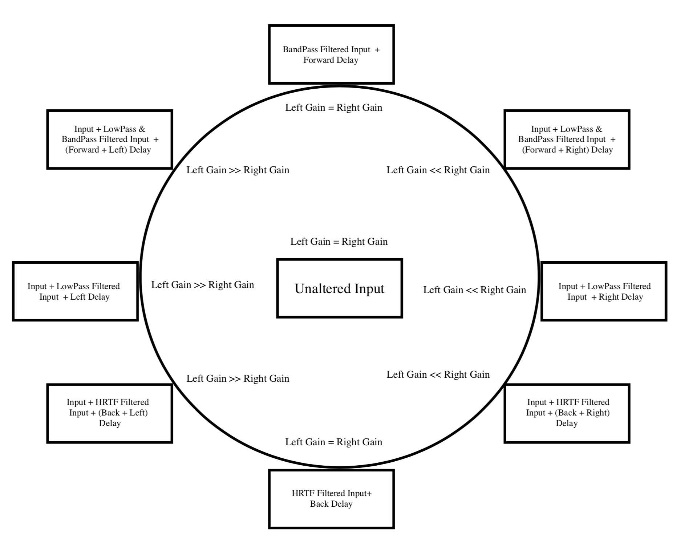

# RealTimeBinauralPanning
Real-time binaural panning on a BeagleBone Black with the Bela audio cape, with the sound source positioned by an accelerometer.

Written during my MSc in Sound and Music Computing at Queen Mary University of London (2017 to 2018). This was the final project for the Real-Time DSP module.

The approach considered utilises an Accelerometer to position the sound source. 
The sound source localisation is done using the inter-aural level differences (ILD) and head-related transfer function for sound positioning and pinna reflections for the perception of elevation. In addition, filtering and band boosting techniques are also included for increasing the elevation and the depth perception capability.

